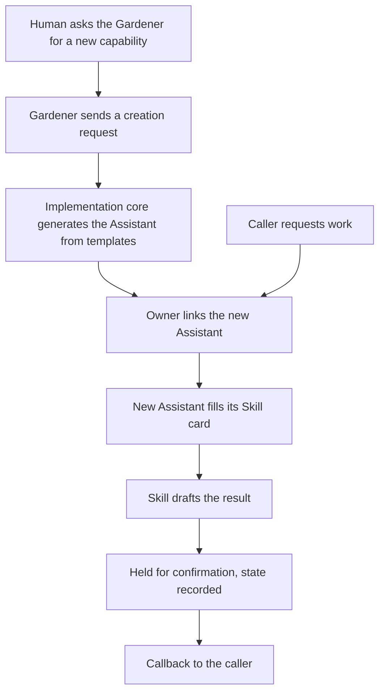

# One assistant from creation to its first card

An entry point asks the implementation core to create a new Assistant from the protocol's templates. The new Assistant then handles its first card correctly using only what it inherited: the patterns, its own description card and the card it receives. No instruction written specially for this Assistant is needed.

Each step ends with a **check**. Together the checks form a smoke scenario for a freshly created Assistant ([core behavior](../concepts/core-behavior.md#verification)).

## 1. Create

A human tells the [Gardener](../concepts/gardener.md): "we need someone to draft release notes for each merged change". The Gardener does not write the new Assistant itself. It sends a [request card](../templates/request-card.md) to the owner of the implementation core's creation capability:

- operation: create an Assistant from the [assistant template](../templates/assistant.md);
- purpose: draft release notes for one merged change;
- owner: the documentation Assistant;
- one owned Skill, *draft release notes*, with its card;
- result destination: the owner's description; completion callback to the Gardener.

The core fills the template. The description card states the purpose, owner, entry and owned Skill; its declared authority is *on its own:* draft notes and comment on items; *with confirmation (owner):* publish notes; *never:* edit the change itself. Its layer stamp names the protocol and core versions it was built from.

**Check:** the new Assistant exists only as generated output of the core; its description has every template section, including declared authority and a layer stamp ([15](../patterns/15-rule-provenance.md), [17](../patterns/17-declared-authority.md)).

## 2. Link

The documentation Assistant's description gains one row in its *Owns* table linking the new Assistant. Nothing else is copied into it ([pattern 5](../patterns/05-describes-only-itself.md)). The Gardener receives the callback with the saved references.

**Check:** the owner links, not repeats; the Gardener was notified once, on completion, with no `pending` updates.

## 3. First card

A caller asks the documentation Assistant for release notes on one merged change and requests a completion callback. The request reaches the new Assistant through its owner. As the Skill's immediate parent, it fills the Skill card from the template, attaches the change reference and runs the Skill.

**Check:** the caller addressed the owner, not the Skill ([1](../patterns/01-single-entry-through-owner.md)); the Skill received a filled card with attached inputs ([2](../patterns/02-skill-card.md)).

## 4. Hold at the authority boundary

The Skill produces a draft. Publishing it is declared *with confirmation*, so the Assistant does not publish. Through the [Publisher](../concepts/publisher.md) it records on the item: the draft reference, the decision to group changes by area and why, and the stop point `waiting: publish · confirmer: owner`. Its agent block names `rule: declared authority · layer: card`.

**Check:** no publication happened; the record alone is enough for another executor to continue ([16](../patterns/16-state-outside-the-conversation.md)); the hold names its rule and layer ([15](../patterns/15-rule-provenance.md)).

## 5. Resume and return

The session ends. Later the owner confirms. A new session reads the record, publishes the notes and fills the caller's predeclared callback with the actual outcome. It does not ask what was decided earlier and does not choose the caller's next step.

**Check:** the resumed run continued from the stop point without redoing recorded decisions; the callback carried the actual result ([3](../patterns/03-callback-as-continuation.md)).

## Variant: a contradicting instruction

If the first request had said "run the Skill directly and publish right away", the new Assistant would still route through its owner and hold publication. It notes both conflicts with the rules and layers involved: owner routing against the request (core wins, [12](../patterns/12-conflicts-resolve-toward-the-core.md)); publishing against its declared authority, which a card may narrow but not widen ([17](../patterns/17-declared-authority.md)).

**Check:** behavior is unchanged and both conflicts are named.

## Smoke checklist

| # | Check | Pattern |
|---|---|---|
| 1 | Created through the core from the template; description complete with authority and stamp | [15](../patterns/15-rule-provenance.md), [17](../patterns/17-declared-authority.md) |
| 2 | Owner links the new element; creator notified on completion only | [5](../patterns/05-describes-only-itself.md), [3](../patterns/03-callback-as-continuation.md) |
| 3 | First request enters through the owner; Skill receives a filled card | [1](../patterns/01-single-entry-through-owner.md), [2](../patterns/02-skill-card.md) |
| 4 | Action outside "on its own" is held, with confirmer | [17](../patterns/17-declared-authority.md) |
| 5 | Decisions, progress and stop point recorded at the item | [16](../patterns/16-state-outside-the-conversation.md) |
| 6 | Resume from the record in a new session | [16](../patterns/16-state-outside-the-conversation.md) |
| 7 | Callback filled with the actual outcome; no invented next step | [3](../patterns/03-callback-as-continuation.md) |
| 8 | Contradicting instruction loses; conflict names rules and layers | [12](../patterns/12-conflicts-resolve-toward-the-core.md), [15](../patterns/15-rule-provenance.md) |

See [one request through the protocol](request-lifecycle.md) for routing, nested delegation and queues in more detail.
