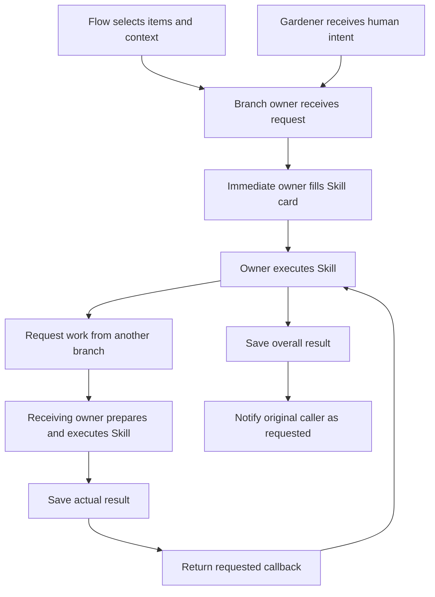

# One request through the protocol

A request reaches a Skill through its owning Assistant. The result has a destination; a callback is an optional continuation for a specific caller.

At every handoff, apply [reasonable sufficiency](../patterns/11-reasonable-sufficiency.md). Read the known next participant's accessible task/contract at intake. Preserve relevant information encountered during the current task with references and explicit unknowns; collecting missing downstream information remains the next participant's work unless it is already required by the current task. Every written result has a human part and an agent block ([two audiences](../patterns/14-two-audiences.md)); shared-record writes go through the [Publisher](../concepts/publisher.md).

## Scheduled refinement

1. A Flow selects at most five items using its configured filter and order. Five is this example's limit, not a universal protocol limit.
2. It sends the items, requested Skill and recurring-launch context to the branch owner, with no outer callback.
3. The request travels to the Skill's immediate owner, which fills its input card.
4. During execution the Assistant may request another role's contribution. It decides callback need for that nested call.
5. Save the overall result where the Flow's next iteration will observe it, through the Publisher. If a result with the same marker already exists (for example, after a retried run), merge into it quietly instead of adding a second one. No outer callback does not remove nested continuation requirements.
6. When the item's next stage is foreseeable, the agent block carries a `prepared for: <next Flow or Skill>` section built from material already gathered. The next run treats it as a recommendation.

## Publishing followed by review

A Developer asks a Publisher to prepare a draft PR with specified content and attachments. Before delegation, the Developer declares a continuation: return the saved PR reference and publication outcome so its own draft-review Skill can run.

The Publisher's owner fills its Skill card and executes the work. The Publisher fills the actual result in the prepared callback; it does not invent the Developer's next step. On receipt the Developer validates the result, prepares the input for its own review Skill and runs it through its owner. Admission to review follows that check's actual outcome.

## Requests arriving while busy

The incoming worker keeps new requests separate, links prior cards and decisions, and assembles attributed context while the executor is busy. It does not rewrite the active card. A later request concerning the same item waits for its own execution and retains its own return destination.

A caller requesting completion only is not woken for `pending` or queue-position updates. Progress updates need an explicit subscription. A Gardener-marked Emergency takes the next slot without implicitly interrupting active work.
